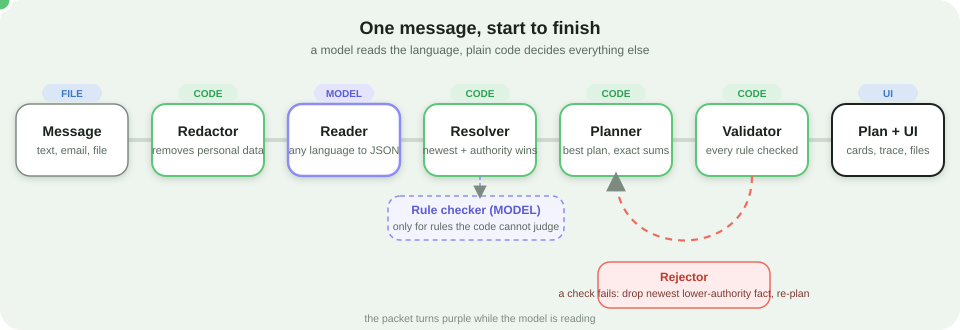
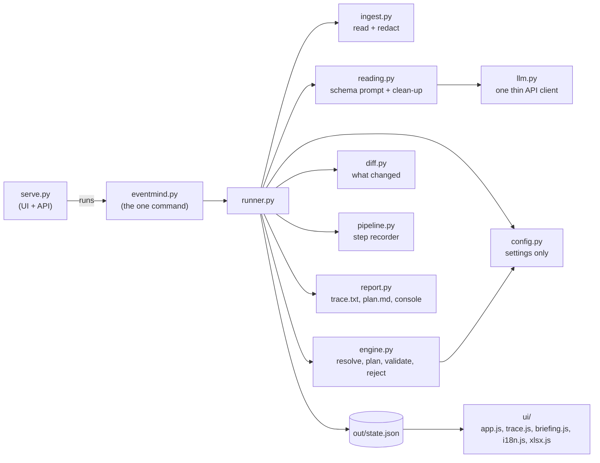
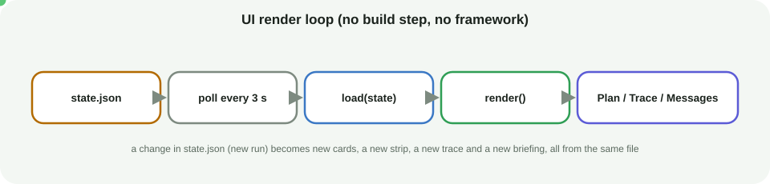

# EventMind architecture

> **A model reads the language. Code does everything else.** Fewer tokens score higher, and code is never wrong at sums.

The diagrams on this page are animated SVGs. GitHub plays them inline. If you read this file in an editor that does not animate images, every diagram is also described in text next to it.

## 1. The whole system in one picture

<p align="center"></p>

A message packet travels left to right. It turns purple while the one model call is reading, and the dashed red arrow is the reject loop (section 5).

| Agent | Kind | Runs | Input | Output |
|---|---|---|---|---|
| **Redactor** | code | before any model call | raw text | text without phones, emails, IDs, card numbers |
| **Reader** | **model** (tag `reading`) | once per run that has new text | new text (+ existing keys on updates) | fixed English JSON: messages, language, facts, questions |
| **Rule checker** | **model** (tag = the rule's area) | only for a rule the code cannot judge, cached | rule text + that area's plan section | `{ok, why, allowed}` |
| **Resolver** | code | every run | all facts | active / stale / rejected / optional / needs-review |
| **Planner** | code | every run | active facts | best plan over every venue x food option |
| **Validator** | code | inside the planner | plan + rules | pass/fail per check |
| **Rejector** | code | when a check fails | facts + checks | the wrong fact, with the failing rule as the reason |
| **Change tracker** | code | every run | old plan, new plan | list of changed values |
| **Briefer** | code (in the browser) | every render | validated plan | plain-language summary (English or Urdu) |

There is **one model role and one optional checker**. Everything else is plain code, so arithmetic is exact and free.

## 2. What happens when you press *Process message*

<p align="center"></p>

1. The browser sends the text (or an attached `.eml`, `.docx`, `.pdf`, `.txt`) to `serve.py`.
2. `serve.py` saves it under `inbox/` and runs **the same command a person would type**: `python eventmind.py <file>`.
3. `eventmind.py` redacts personal data and keeps only text it has not seen before.
4. **One** reading call goes to the model API (a full run and an update both use one call).
5. Plain code resolves the facts, plans, validates and runs the reject loop.
6. The plan, the call trace and the step-by-step pipeline are saved to `out/state.json` (plus `trace.txt` and `plan.md`).
7. The browser already polls `/state.json` every 3 seconds, sees the new run and redraws.

The model never sees `out/`, `.env` or other runs' data, and the UI never talks to the model.

## 3. Module map



| File | Single purpose (two sentences at most) |
|---|---|
| `eventmind.py` | The one command: `python eventmind.py <file>` or `reset`. No flags or hints. |
| `eventmind/runner.py` | Orchestrates one run: read, find new text, reading call, plan, save. Decides full run vs update from saved state only. |
| `eventmind/ingest.py` | Reads a file exactly as given (txt, md, csv, json, eml, docx, pdf) and redacts personal data by pattern. |
| `eventmind/reading.py` | The only place language is understood: the schema prompt, language tags, follow-up questions, original-text slicing. |
| `eventmind/llm.py` | One OpenAI-compatible client. Records every call (model, area, input, output, tokens as reported, ms) and retries once without strict JSON mode. |
| `eventmind/engine.py` | Resolve, plan, validate and the reject loop. Standard library only. |
| `eventmind/diff.py` | Lists which plan values changed after a run. |
| `eventmind/pipeline.py` | Records every step (code and model) of a run with real timings for the Trace page. |
| `eventmind/report.py` | Writes `trace.txt`, `plan.md` and the console summary. |
| `eventmind/config.py` | Settings and role ranks. Never contains facts from any message pack. |
| `serve.py` | Serves `ui/`, `/state.json`, `/api/message`, `/api/reset`. |
| `ui/*` | A build-free dashboard: plain HTML, CSS and JavaScript. Works offline. |

**Core rule:** the core uses only the Python standard library. `python-docx` and `pypdf` are optional and only add `.docx` and `.pdf` input.

## 4. The pipeline in detail

1. **Ingest (code).** Read the file as given, any language or script. Remove phones, emails, national IDs and card numbers by pattern (digits look the same in every language). Only text not seen before continues: a new file, or the same file with messages appended, or nothing (0 model calls).
2. **Reading (1 model call, tag `reading`).** The whole new text goes in once. Out comes a fixed English schema: for each message the sender, role, date, **language tag**, verbatim quote, English gist, flags, **follow-up questions** and facts. Fact types: `event`, `venue`, `food`, `judges`, `expense`, `optional`, `break`, `quantity`, `rule`. On updates the model also gets the existing fact keys, so a correction reuses the same key.
3. **Tagging (code).** Messages are matched back to the original text (the next message's header lines are cut off), languages are normalised (`ur-Latn`, `mixed`, `und`), and plain code adds a follow-up question when a required number is missing.
4. **Resolve (code).**
   - `legal` or `disputed` flag: `needs_review`, never applied.
   - Event fundamentals (budget, students, duration, staff) can only be set by the `approver` role.
   - Same key: the newest date wins (an undated new message counts as newest); the older fact becomes `stale`.
   - A lower-authority sender cannot override a higher one. Rules from low-authority senders are requests, shown as `optional`.
   - `optional` items are never added to the total, only shown with whether they fit.
5. **Plan (code).** Try every venue x food option. For each, compute headcount, judges, schedule and budget, run the validator, and pick: fewest failed checks, then standard tier, then lowest total cost.
6. **Validate (code).** All five areas planned, venue fits everyone, food for every person, within budget, enough judges, judge load, schedule fills the event length, required breaks, plus every extracted rule.
7. **Reject loop (code).** See section 5.
8. **Unusual rules (optional model call).** A rule whose metric the code does not know (or a feature requirement worded differently from every venue's tags) gets one small call tagged with the rule's **area**. The answer is cached in `state.model_checks`.
9. **Track changes and save.** `diff.py` lists changed values, `pipeline.py` has recorded every step, and the state is written to `out/`.

### Formulas (all from extracted facts)

- teams = ceil(students / team size), or teams given directly
- judges needed = ceil(teams / max teams per judge)
- headcount = students + staff + judges used + other people
- judging block = teams per judge x minutes per team (judges work in parallel)
- schedule = opening 15 + build + lunch 30 + required breaks + build + judging + closing 15 = event length (a 0-minute judging block is left out)
- food = meals x price per head x (1 + service charge %) + delivery fee
- total = committed expenses + venue + food + judges x honorarium

## 5. The reject loop

<p align="center"></p>

If checks still fail after the best option is chosen, the engine tries removing the **newest lower-authority fact**. If that makes every check pass, the fact is rejected, and the exact failing rule becomes the reason shown on the **Rejected** tab and in the trace. The loop repeats up to five times, so a plausible but wrong message can never silently break a valid plan.

## 6. Trace and pipeline (what the judges see)

Every step of a run is recorded in `state.pipeline`, and every model call in `state.trace`:

| Step kind | Examples | Recorded |
|---|---|---|
| `io` | message file received, state saved | what and how many characters |
| `code` | redactor, tagging, resolver, planner, validator, rejector, change tracker | counts and decisions, real milliseconds where measured |
| `model` | reading call, rule-check call | call number, model name, area tag, tokens exactly as the provider reported them, milliseconds, error if any |

Token counts are **copied from the provider, never estimated**; an unknown count stays `n/a`. The **Trace** tab plays the recorded steps back as an animation (agent rail, step cards, running counters) with Replay, Show all, speed and a run selector. Click *View input and output* on a model step to read the full prompt and reply.

## 7. Data model: `out/state.json`

| Key | Contents |
|---|---|
| `messages[]` | `n`, `run`, `sender`, `role`, `date`, `lang`, `text`, `gist`, `flags`, `ask`, `status`, `reason`, `areas`, `facts[]` (each with `status` and `reason`) |
| `plan` | `headcount`, `venue` (with options), `food` (with options), `judging`, `schedule` (blocks), `budget` (lines, optional) |
| `checks[]` | `label`, `area`, `expected`, `actual`, `ok` |
| `rejected[]` | the rejected message, fact and reason |
| `decisions[]`, `privacy[]` | notes for a human; redaction and review notes |
| `runs[]` | `run`, `kind` (full/update), `calls`, `tokens`, `changed_areas`, `changes`, `new_messages`, `duration_ms` |
| `trace[]` | numbered model calls: `n`, `run`, `model`, `area`, `input`, `output`, `prompt_tokens`, `completion_tokens`, `total_tokens`, `ms`, `error` |
| `pipeline[]` | the step-by-step record per run (`stage`, `agent`, `kind`, `title`, `detail`, `ms`, `call`) |
| `raw_seen[]`, `model_checks`, `events[]`, `totals` | already-processed text (for new-text detection), cached rule answers, decision log, token totals |

The UI is a pure function of this file: load it from the server, drop it on the page, or open it with *Open saved plan*.

## 8. The website

<p align="center"></p>

| Part | What it does |
|---|---|
| **Plan** | Five cards (budget, venue, schedule, food, judging), a strip for what was just processed, schedule timeline and budget donut, a short *Needs attention* card with answer boxes, and a folded *More details* section. Each part shows only when the input has that data. |
| **Messages** | Add text, an email (paste or `.eml`) or a document. Every message shows a language badge, status, English gist, reason, follow-up questions and the extracted facts. |
| **Rejected** | Messages that broke a rule or came without authority, with the exact reason. |
| **Trace** | The animated step-by-step trace and every model call. |
| **Runs & changes** | One card per run: new messages, model calls, tokens, changed areas. |
| **Toolbar** | English / Urdu switch (right-to-left), *New event* (backup kept), *Open saved plan*, *Download Excel* (10 sheets), schedule download (Excel or CSV), summary download. |

Design choices: no build step and no framework, all labels in one dictionary (`ui/i18n.js`), light and dark themes, a mobile layout, and a hand-written zip + SpreadsheetML writer (`ui/xlsx.js`) so the Excel export works offline.

### HTTP surface (`serve.py`)

| Route | Purpose |
|---|---|
| `GET /` and static files | the UI, always sent with `Cache-Control: no-store` |
| `GET /state.json` | the saved state, or an empty state when nothing has run yet |
| `POST /api/message` | `{text, files[]}`: saves to `inbox/` and runs the same command as the terminal. Only `.txt .md .eml .csv .json .docx .pdf`, up to 10 MB, and the file name is never trusted. |
| `POST /api/reset` | *New event*: copies the state to `inbox/state_backup_*.json`, then clears it |

## 9. Who may change what

Roles are ranked in `config.py`: `approver` 3; `venue`, `caterer`, `judging`, `finance`, `vendor` 2; `participant`, `other` 1. The ranks are about the sender's role, never about a specific pack. Rejections look at the newest lower-authority fact first.

## 10. What breaks without each part

| Part | Without it |
|---|---|
| Redaction | Personal data sent to a third-party model |
| Reading call | No way to understand any language or new phrasing |
| Fixed schema | Code cannot plan; every new pack would need new code |
| Existing keys in the update prompt | Corrections create duplicate facts instead of replacing |
| Newest-wins | Old prices (stale quotes) used |
| Authority ranks | A vendor could change the budget |
| Option search + validator | The plan could exceed the budget or not fit the people |
| Reject loop | A wrong message silently breaks the plan |
| Trace + pipeline | Judges cannot verify tokens, models and areas |
| State + new-text detection | Every update would re-read everything (more tokens, more calls) |
| Follow-up questions | A vague message silently changes nothing and nobody knows why |

## 11. Limits, privacy and safety

- Update runs allow at most 5 model calls; full runs and updates have call timeouts (`config.py`).
- `.env`, `out/` and `inbox/` are never committed; `scripts/ship.sh` refuses to push if `out/` or `.env` is tracked, and `scripts/package.*` builds a zip without them.
- A failed reading is not marked as seen, so running the same command again retries it.
- The model can mislabel a sender's role or skip a message on a long pack. The plan is only as good as the reading, which is why every reading is in the trace.

## 12. Tests and running

```bash
python -m unittest -v        # 31 tests, invented data only, no model needed
python eventmind.py reset    # fresh start
python eventmind.py <file>   # the one command (full run, then updates)
python serve.py              # the website at http://localhost:8000
```

Deep links used for documentation screenshots: `/?tab=trace&trace=all&lang=ur&theme=dark&open=menu|email|details`.
